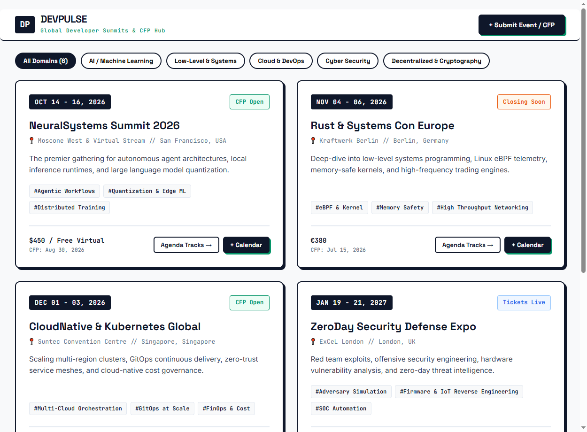
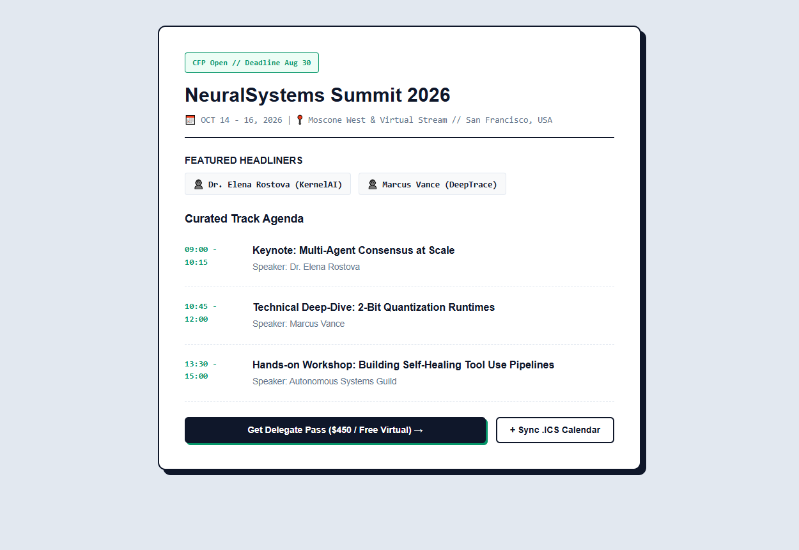
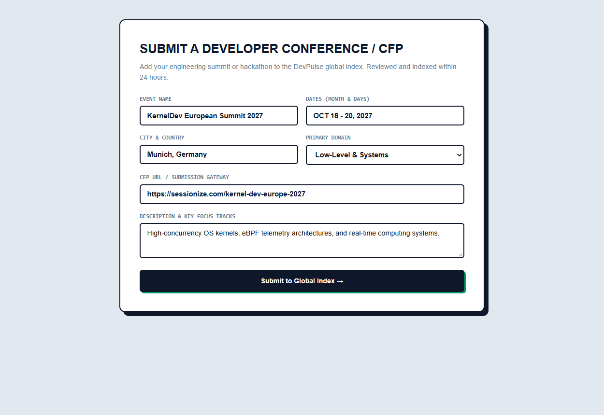

# DevPulse — Global Developer Conferences & CFP Aggregator

Международный хаб и поисковый агрегатор инженерных конференций, хакатонов и открытых Call for Papers (CFP) для разработчиков и архитекторов программного обеспечения.

Выполнен в эстетике **Swiss Typographic & High-Contrast Grid**: строгая черно-белая палитра (`#0F172A`, `#FFFFFF`, `#F8F9FA`), выразительные акцентные бейджи изумрудного (`#059669`) и оранжевого (`#EA580C`) оттенков, архитектурные плашки дат `[ OCT 14 - 16 ]`, геометрический гротеск *Space Grotesk* и моноширинный шрифт *JetBrains Mono*.

---

## Визуальный обзор платформы

### 1. Каталог инженерных саммитов и тематические фильтры
Двухколоночный каталог конференций с категоризацией (AI/ML, Systems Programming, Cloud & DevOps, Security, Web3, Frontend), фильтрацией по формату (In-Person / Hybrid / Virtual) и статусу подачи докладов (CFP Open / Closing Soon).



### 2. Расписание треков и спикеры (Agenda & Tracks Drawer)
Детальный таймлайн программы конференции с разбивкой на кейноуты, практические воркшопы и панельные дискуссии, именами хедлайнеров и кнопкой экспорта в персональный календарь (.ics).



### 3. Интерактивная форма добавления конференции (Submit CFP)
Модальный интерфейс для организаторов и спикеров с валидацией метаданных: город проведения, ссылки на Sessionize/Papercall, список технических треков и сроки закрытия заявок.



---

## Архитектура и стек

- **Frontend:** Vanilla JavaScript (ES6+), семантический HTML5, CSS Grid & Flexbox, CSS Custom Properties, нативные модальные диалоги без внешних тяжелых библиотек.
- **Backend:** `server.py` на стандартной библиотеке Python 3 (`http.server` с кастомным логированием), опционально совместим с FastAPI/Uvicorn.
- **Данные:** Локальный JSON-каталог `data/events.json`, структурированный по схемам событий с детальными расписаниями и профилями спикеров.
- **Функциональные возможности:**
  - Живой поиск по названию, городу или тематическому тегу.
  - Мгновенная фильтрация по категориям через интерактивные чипсы.
  - Модальные окна с клавиатурной навигацией (Escape, клик по оверлею).
  - Интеграция с локальной очередью событий календаря.

---

## Быстрый старт

### Запуск через Python
```bash
cd 11-event-hub-aggregator
python server.py
```
После запуска откройте в браузере: [http://127.0.0.1:8004](http://127.0.0.1:8004)

### Автономный просмотр
Файл `index.html` полностью автономен и открывается двойным кликом в браузере без предварительной сборки.

---

## Структура проекта

```
11-event-hub-aggregator/
├── assets/
│   ├── preview-events.png     # Скриншот каталога событий
│   ├── preview-detail.png     # Скриншот расписания и спикеров
│   └── preview-submit.png     # Скриншот формы добавления события
├── data/
│   └── events.json            # База данных конференций и CFP
├── static/
│   ├── css/
│   │   └── style.css          # Стили Swiss Grid
│   └── js/
│       └── main.js            # Логика каталога, фильтрации и модальных окон
├── index.html                 # Разметка страницы
├── server.py                  # Веб-сервер
├── requirements.txt           # Спецификация
└── README.md
```

